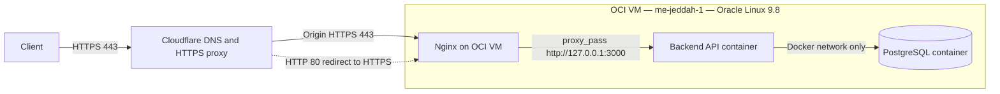

# Deployment Guide

Internship deployment documentation for the Smart.sa Semicolon-team project **cloud-devops-smart.sa-semicolon-team** (author: Mansoor Gabali, project period: 10/2026).

This document describes the **existing** local development workflow and the **completed** Oracle Cloud Infrastructure (OCI) production deployment. It does not provision new cloud resources.

---

## 1. Environments at a glance

| Concern | Local development | Production (OCI) |
|---------|-------------------|------------------|
| Host OS | Windows development machine | Oracle Linux 9.8 on OCI |
| Compute | Developer workstation | ARM64 A1 Flex VM (`me-jeddah-1`) |
| API process | `npm run dev` or Compose `api` service | Docker Compose `api` container |
| Database | Compose `db` on host port `55432` | PostgreSQL container on the Docker network (not publicly exposed) |
| Public entry | `http://localhost:3000` | Cloudflare → Nginx → `127.0.0.1:3000` |
| TLS | Optional / none | HTTPS via Cloudflare; origin TLS on Nginx (Cloudflare Origin CA) |
| Domain | N/A | `smartsa-staj.mns70.com` |
| Secrets | Local `.env` (not committed) | Server env / GitHub Actions secrets |

Repository Compose file name: **`compose.yaml`**.

---

## 2. Local development (Windows CMD)

Use these commands on the **Windows development machine**. They do not change the OCI VM.

### Prerequisites

- Node.js 20 and npm
- Docker Desktop (or Docker Engine) with Compose
- Git

### Setup

```cmd
cd /d <path-to>\cloud-devops-smart.sa-semicolon-team
copy .env.example .env
npm ci
docker compose up -d db
npm run prisma:migrate:deploy
npm run dev
```

Local API: `http://localhost:3000`

Compose maps PostgreSQL to host port **`55432`** (container port remains `5432`) so it does not collide with a local PostgreSQL install. Configure `DATABASE_URL` from `.env.example`. Never commit `.env`.

### Full local stack (API + DB containers)

```cmd
docker compose up --build
```

### Local verification

```cmd
curl http://localhost:3000/health
curl http://localhost:3000/health/ready
```

### Local checks

```cmd
npm run lint
npm run typecheck
npm test
npm run build
docker compose ps
docker compose logs -f api
docker compose down
```

`docker compose down` does not remove the named volume `postgres_data`. Do not remove volumes unless you intend to delete local database data.

---

## 3. Production architecture (OCI)

### Verified infrastructure

| Item | Value |
|------|--------|
| Provider | Oracle Cloud Infrastructure (OCI) |
| Region | `me-jeddah-1` |
| Operating system | Oracle Linux 9.8 |
| Compute | ARM64 A1 Flex shape VM |
| Public domain | `smartsa-staj.mns70.com` |
| DNS / public HTTPS edge | Cloudflare |
| Reverse proxy | Nginx (HTTP → HTTPS redirect; TLS termination on the origin) |
| Origin TLS | Cloudflare Origin CA certificate on Nginx |
| Backend | Node.js 20, TypeScript, Express (Docker image from `Dockerfile`) |
| Orchestration | Docker Compose (`compose.yaml`) |
| Database | PostgreSQL 16 (Compose `db`) with named volume `postgres_data` |
| ORM / migrations | Prisma (`npx prisma migrate deploy` at container start) |
| Internal API target | `127.0.0.1:3000` (Nginx upstream; deploy health check uses the same URL) |
| Public liveness | `https://smartsa-staj.mns70.com/health` |
| Public readiness | `https://smartsa-staj.mns70.com/health/ready` |

The VM public IP is intentionally omitted from this document. Do not publish passwords, private keys, certificate private-key material, or database credentials.

### Request flow



**Boundaries**

- Public internet reaches the VM through Cloudflare on ports **80** and **443** (HTTP redirects to HTTPS).
- Nginx terminates TLS at the origin and forwards to the backend on **loopback** `127.0.0.1:3000`.
- PostgreSQL is reached by the API over the Compose Docker network (`db:5432`). It is **not** intended for public host-port exposure in production.
- SSH access to the VM is restricted; application secrets are not stored in Git.

### Application container startup

The production API image is defined by `Dockerfile`. The process command is:

```text
npx prisma migrate deploy && node dist/server.js
```

Migrations therefore run when the API container starts, before the HTTP server listens.

Compose `restart: unless-stopped` keeps services running across VM reboots unless they are stopped deliberately.

---

## 4. Continuous integration and deployment

Workflow file: `.github/workflows/ci.yml` (workflow name: **CI/CD**).

Triggers: `push` and `pull_request` to `main`/`master`, plus `workflow_dispatch`.

### Continuous Integration job (`build-and-test`)

Runs on every matching push and pull request:

1. Checkout
2. Setup Node.js 20 with npm cache
3. `npm ci`
4. `npm run lint`
5. `npm run typecheck`
6. `npx prisma migrate deploy` against the workflow Postgres service (`tasks_db_test`)
7. `npm test`
8. `npm run build`

### Continuous Deployment job (`deploy`)

Runs only when **all** of the following are true:

- The CI job succeeded (`needs: build-and-test`)
- The event is **not** a pull request
- The ref is `refs/heads/master`
- The GitHub Environment `production` is used

Secrets consumed by the deploy step (never committed to the repository):

| Secret | Purpose |
|--------|---------|
| `OCI_HOST` | SSH host for the OCI VM |
| `OCI_USER` | SSH username |
| `OCI_SSH_PRIVATE_KEY` | SSH private key used by the runner |

Deploy sequence (executed by the workflow over SSH):

```bash
cd ~/apps/cloud-devops-smart.sa-semicolon-team
git pull --ff-only origin master
sudo docker compose up -d --build api
curl --fail --silent --show-error http://127.0.0.1:3000/health
```

The runner writes the private key to a temporary file, connects with `IdentitiesOnly=yes`, then removes the key file. Host keys are collected with `ssh-keyscan` (see future improvements regarding host-key pinning).

Treat a release as fully pipeline-verified only when the corresponding GitHub Actions run shows both **Continuous Integration** and **Continuous Deployment to OCI** as successful.

---

## 5. Operations on the OCI VM

Run these commands **on the OCI VM** (after SSH), not on the Windows development machine.

Application directory used by CI/CD:

```text
~/apps/cloud-devops-smart.sa-semicolon-team
```

### Inspect containers and logs

```bash
cd ~/apps/cloud-devops-smart.sa-semicolon-team
sudo docker compose ps
sudo docker compose logs -f api
sudo docker compose logs -f db
```

### Manual rebuild (break-glass)

```bash
cd ~/apps/cloud-devops-smart.sa-semicolon-team
git pull --ff-only origin master
sudo docker compose up -d --build api
curl --fail --silent --show-error http://127.0.0.1:3000/health
```

### Public verification (from any machine)

```bash
curl -i https://smartsa-staj.mns70.com/health
curl -i https://smartsa-staj.mns70.com/health/ready
```

Verified responses (10/2026):

- `GET /health` → HTTP 200, JSON with `"status":"ok"` and `"service":"cloud-devops-backend"`
- `GET /health/ready` → HTTP 200, JSON with `"status":"ready"` and `"checks":{"database":"up"}`

---

## 6. Security controls (current)

- **SSH:** Access to the VM is restricted; credentials live in GitHub Actions secrets / operator key material, not in the repository.
- **Ingress:** Public application traffic is intended on HTTP/HTTPS only; Cloudflare fronts the domain.
- **TLS:** Browsers terminate at Cloudflare; Nginx presents a Cloudflare Origin CA certificate toward Cloudflare.
- **Nginx:** Reverse proxy and HTTP→HTTPS redirect; backend reached at `127.0.0.1:3000`.
- **Secrets:** `.env` / production environment files and private keys are excluded from Git (see `.gitignore`). Production env files on the server should use restrictive file permissions (for example owner-read-only).
- **Database isolation:** PostgreSQL is used via the Docker network from the API container; it is not published as a public service endpoint.
- **Application hardening:** Helmet headers, env-driven CORS, body size limits (`BODY_LIMIT`), Zod validation, and non-root container user in the `Dockerfile` runner stage.

---

## 7. Troubleshooting

| Symptom | Likely area | What to check |
|---------|-------------|----------------|
| Public site unreachable | DNS / Cloudflare | Cloudflare DNS record for `smartsa-staj.mns70.com`; proxy status (orange cloud); origin host reachable on 443 |
| Browser TLS errors | Cloudflare / Nginx TLS | Origin certificate installed and valid for Nginx; Cloudflare SSL mode compatible with Origin CA |
| `502` / `504` from Nginx | Upstream API | `sudo docker compose ps`; `curl http://127.0.0.1:3000/health` on the VM; `sudo docker compose logs api` |
| `/health` OK but `/health/ready` fails | Database | `sudo docker compose ps db`; API `DATABASE_URL` host should be Compose service `db`; DB volume and logs |
| Deploy job fails at SSH | Secrets / network | `OCI_HOST`, `OCI_USER`, `OCI_SSH_PRIVATE_KEY`; VM SSH ingress from GitHub Actions runners (or fixed allow list if used) |
| Deploy fails at `git pull` | Server Git state | Clean tree under `~/apps/cloud-devops-smart.sa-semicolon-team`; remote `origin` tracks `master` |
| Deploy fails at Compose build | Docker on VM | Disk space; Docker daemon; ARM64 image build logs from `sudo docker compose up -d --build api` |
| CI fails locally-reproducible tests | App / DB in CI | Workflow Postgres service health; Prisma migrations; `npm test` on Windows with Compose DB running |

---

## 8. Future operational improvements

The following are **not** claimed as implemented:

- Scheduled database backup and a documented restore drill
- Monitoring and alerting for availability and resource usage
- SSH host-key pinning for the GitHub Actions deploy step (instead of relying only on `ssh-keyscan`)
- Documented image/tag rollback for a failed release
- Deployment notifications and release history beyond GitHub Actions run logs

---

## 9. Related documentation

- [README.md](../README.md) — project overview and live health link
- [ARCHITECTURE.md](./ARCHITECTURE.md) — application components and data model
- [TESTING.md](./TESTING.md) — test strategy and commands
- [CONTRIBUTING.md](../CONTRIBUTING.md) — contribution and secret-handling expectations
